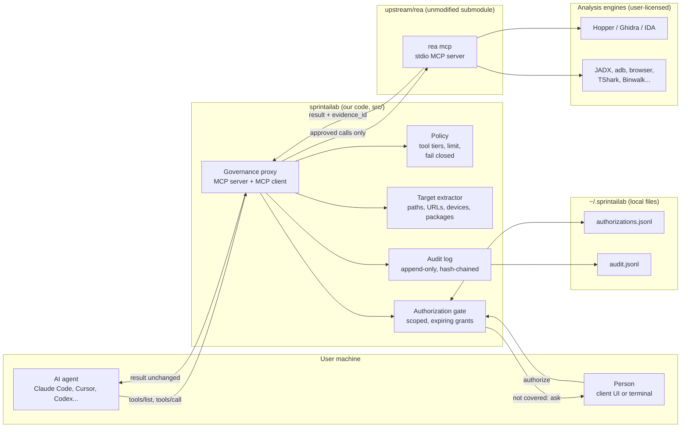
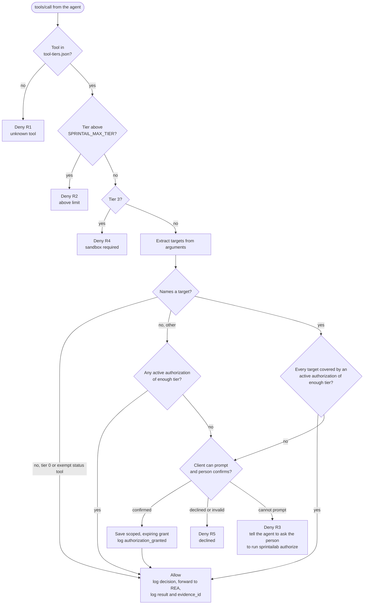
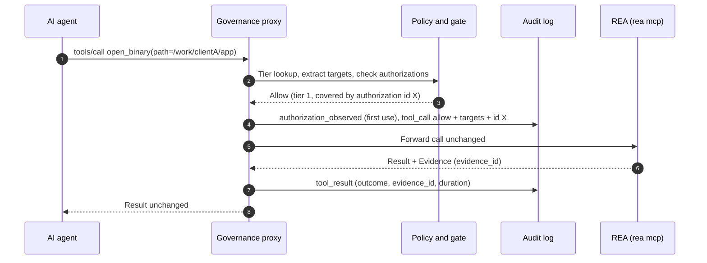
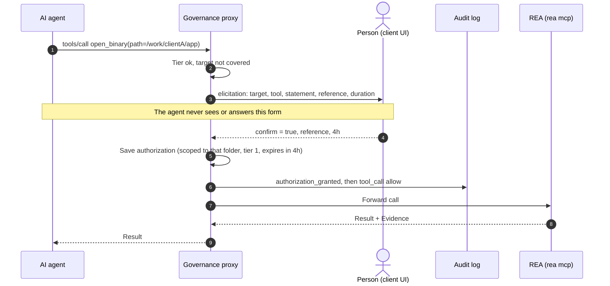
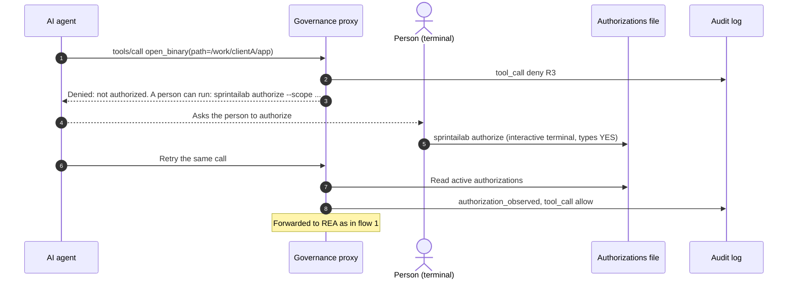
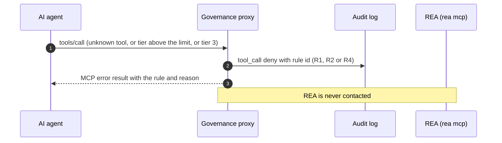
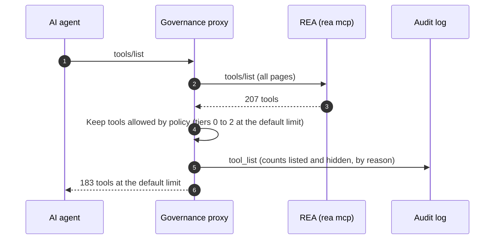
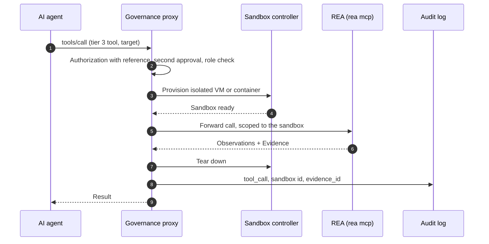

# sprintailab: governed AI reverse engineering (MCP proxy for REA)

[](src) [](#prerequisites) [](#security-model-and-known-limits) [](https://modelcontextprotocol.io)

**sprintailab is an open-source governance layer for AI-assisted reverse engineering.** It is an MCP (Model Context Protocol) proxy that sits between an AI agent (Claude Code, Cursor, Codex, Gemini CLI) and [REA, Reverse Engineer Anything](https://github.com/morluto/rea). Before any analysis runs, it checks that a person has authorized the target, enforces risk tiers on all 207 REA tools, and writes every decision to a tamper-evident audit log.

**Why this exists:** AI agents can now analyze binaries, Android apps, Electron apps, websites and firmware without source code. That is useful for legacy modernization, vendor due diligence, interoperability and first-pass security review, and just as easy to misuse. sprintailab gives IT services teams, especially in India, controls they can show a client: who authorized what, under which scope, and what actually ran.

**Who it is for:** IT services and consulting teams, security reviewers, and engineering leads who need AI agents on software they own or are authorized to analyze, with an audit trail, and who need to answer "is this being misused?" with evidence.

> **Status:** early build, working end to end against real REA 6.6.0. Built: tier policy, fail-closed unknown tools, authorization gate (client prompt or terminal), hash-chained audit log, 73 automated tests. **Not built:** sandbox for tier 3 tools, roles, central deployment, India-specific legal review. This is engineering work, not legal advice; see [Licensing and legal](#licensing-and-legal).

**Keywords:** AI governance, responsible AI, reverse engineering, MCP server, Model Context Protocol, audit log, authorization, AI agent security, software due diligence, DPDP, India.

## Contents

1. [What it does](#what-it-does)
2. [Architecture](#architecture)
3. [How every call is decided](#how-every-call-is-decided)
4. [Sequence diagrams](#sequence-diagrams)
5. [Prerequisites](#prerequisites)
6. [Install and build](#install-and-build)
7. [Connect it to your agent](#connect-it-to-your-agent)
8. [Authorizing a target](#authorizing-a-target)
9. [Configuration](#configuration)
10. [Tool tiers](#tool-tiers)
11. [Audit log](#audit-log)
12. [Verify it works](#verify-it-works)
13. [Updating REA](#updating-rea)
14. [Troubleshooting](#troubleshooting)
15. [Security model and known limits](#security-model-and-known-limits)
16. [Repository layout](#repository-layout)
17. [Roadmap](#roadmap)
18. [FAQ](#faq)
19. [Licensing and legal](#licensing-and-legal)

## What it does

REA lets an AI agent investigate software without its source code: native binaries, Electron apps, Android packages, websites, .NET assemblies, firmware and more. It returns findings with evidence. That power can be misused, so sprintailab wraps it:

- **Authorization per target.** A person declares ownership or written permission, scoped to a folder, web origin, device or package, with an expiry (4 hours by default, 24 at most). Live-system work also needs a reference id (ticket, contract or written permission).
- **Risk tiers for all 207 REA tools.** Read-only and local-analysis tools run once authorized. Tools that execute code are blocked until a sandbox exists. Any tool not on the list is denied, so a new upstream tool cannot slip through.
- **Audit trail.** Every decision is appended to a hash-chained log: who, which tool, which targets, under which authorization.
- **REA stays unmodified.** It is included as a git submodule and started as a normal `rea mcp` process, so upstream updates are a submodule bump.

## Architecture

The agent talks MCP to the proxy instead of to REA. The proxy is both an MCP server (facing the agent) and an MCP client (facing REA).



### Trust boundaries

| Boundary | What crosses it | Control |
| --- | --- | --- |
| Agent to proxy | Tool calls with paths, URLs, device ids | Tier policy, target extraction, authorization gate |
| Proxy to person | The authorization prompt or terminal command | The agent cannot see, fill or run it |
| Proxy to REA | Only approved calls | The proxy is the only MCP server registered with the agent |
| REA to engines | Local process calls | Engines are user-licensed; REA owns process lifetime |
| Agent to model provider | Tool results (REA evidence) | Choose the provider and data residency in your client contract |

### Who owns what

| Concern | Owner |
| --- | --- |
| Analysis of binaries, Electron apps, APKs, websites, .NET, firmware | REA (upstream) |
| Evidence records with limitations and `evidence_id` | REA (upstream) |
| Who may analyze what, and proof of the declaration | sprintailab |
| Tool risk tiers, fail-closed handling, tier 3 block | sprintailab |
| Audit trail | sprintailab |

## How every call is decided



| Rule | Meaning |
| --- | --- |
| R0 | Allowed |
| R1 | Tool is not in the approved tier list (fail closed) |
| R2 | Tool's tier is above this deployment's limit |
| R3 | No covering authorization, and the person could not be asked in the client |
| R4 | Tier 3 tools (run or instrument code) need a sandbox, which does not exist yet |
| R5 | The person declined, cancelled, left the box unticked, or gave an invalid scope or missing reference |

## Sequence diagrams

### 1. Call covered by an existing authorization



### 2. Not yet authorized: the person is asked (client supports prompts)



If the person declines, cancels, leaves the box unticked, or omits a required reference, the call is denied with rule R5 and `authorization_declined` is logged.

### 3. Not authorized and the client cannot prompt (terminal path)



### 4. Denied without contacting REA



### 5. Tool listing



### 6. Runtime-capture tool inside a sandbox (planned, not built)

Today every tier 3 tool is denied (R4). The intended flow once a sandbox controller exists:



## Prerequisites

| Need | Version | Notes |
| --- | --- | --- |
| Node.js | 22.19+, 24.11+ or 26+ | REA rejects Node 25 (`EBADENGINE`). Use [nvm](https://github.com/nvm-sh/nvm) to switch |
| npm | 10+ (11 recommended) | npm 10 can fail resolving peer dependencies; use `npx -y npm@11 install` if it does |
| git | any recent | Needed for the submodule |
| An MCP-capable agent | Claude Code, Cursor, Codex, Gemini CLI... | Any client that supports local stdio MCP servers |
| Analysis engines | optional | Hopper, Ghidra or IDA for native binaries; JADX plus a JDK for APKs; adb for devices. Static JavaScript and .NET analysis need none |

## Install and build

```bash
git clone --recurse-submodules https://github.com/nezuko-afk/sprintailab.git
cd sprintailab

# already cloned without submodules?
git submodule update --init --depth 1

nvm install 24 && nvm use 24     # skip if node -v already shows 22.19+, 24.11+ or 26+
npm install
npm run build
npm test                         # 73 tests, about 2 seconds
```

## Connect it to your agent

Register the proxy **instead of** REA, so the agent can only reach REA through the controls.

**Claude Code**

```bash
claude mcp add sprintailab -- node /absolute/path/to/sprintailab/dist/index.js
```

Then run `/mcp` inside Claude Code and confirm `sprintailab` is connected.

**Other clients (Cursor, Gemini CLI, Codex, ...)**: add a local stdio MCP server with command `node` and argument `/absolute/path/to/sprintailab/dist/index.js`. In clients that use a JSON config:

```json
{
  "mcpServers": {
    "sprintailab": {
      "command": "node",
      "args": ["/absolute/path/to/sprintailab/dist/index.js"],
      "env": { "SPRINTAIL_ACTOR": "your.name" }
    }
  }
}
```

Do not also register REA directly; that would bypass every control.

**Which REA does the proxy start?** By default `npx -y rea-agents@<version in policy/tool-tiers.json> mcp`, which matches the version the tiers were generated for. To use your own build (for example if that exact version is not on npm yet), set:

```bash
export SPRINTAIL_REA_COMMAND=node
export SPRINTAIL_REA_ARGS='["/path/to/rea/scripts/rea.mjs","mcp"]'
```

Restart the agent after registering. Ask it something that names a target, for example:

> Analyze the extracted Electron app at /work/clientA/app and map its IPC between renderer and main.

The first call that names `/work/clientA/app` triggers the authorization step below.

## Authorizing a target

Nothing that names a file, URL or device runs until a person authorizes it. There are two ways.

**1. A prompt in the agent's client.** If the client supports MCP elicitation, the person sees a form with the target, the tool, the statement *"I own this target or hold written permission to analyze it, and I will use the results lawfully"*, a confirm box, a reference field and a duration. The agent never sees or fills this form. Tier 2 requires a reference.

**2. The terminal.** When the client cannot prompt, the denial tells the agent to ask the person to run:

```bash
node dist/cli-bin.js authorize --scope /work/clientA/app --tier 1 --ttl 4h
node dist/cli-bin.js authorize --scope adb:R5CT123 --tier 2 --reference JIRA-482
node dist/cli-bin.js list
node dist/cli-bin.js revoke <authorization-id>
node dist/cli-bin.js verify-audit
```

Run `npm link` once to get a plain `sprintailab` command instead of `node dist/cli-bin.js`. `authorize` refuses to run without an interactive terminal and needs a typed `YES`.

**Scopes**

| Scope | Example | Covers |
| --- | --- | --- |
| Folder | `/work/clientA/app` or `path:/work/clientA/app` | that folder and everything under it (symlinks and `..` are resolved) |
| Web origin | `https://app.example.com` | exactly that origin |
| Host | `host:*.example.com` | subdomains (not the bare domain) |
| Android device | `adb:R5CT123` | one device serial |
| Package | `package:com.example.app` | one package id |
| Device | `device:usb` | one Frida device id |

Whole-disk, home-folder, one-level paths like `/tmp`, and wildcard-everything scopes are rejected. A tier 1 authorization does not unlock tier 2 tools. Calls that name no target (for example adding a comment in an open binary) need any active authorization of enough tier. A few status-only tools run without one.

## Configuration

| Variable | Meaning | Default |
| --- | --- | --- |
| `SPRINTAIL_MAX_TIER` | Highest tier this deployment may use, 0 to 3 (tier 3 is always denied for now) | `2` |
| `SPRINTAIL_HOME` | Folder for the audit log and authorizations | `~/.sprintailab` |
| `SPRINTAIL_AUDIT_PATH` | Audit log file | `<home>/audit.jsonl` |
| `SPRINTAIL_AUTH_PATH` | Authorizations file | `<home>/authorizations.jsonl` |
| `SPRINTAIL_ELICITATION` | `off` to disable in-client prompts and require the terminal | on |
| `SPRINTAIL_REA_COMMAND` | Command that starts REA | `npx` |
| `SPRINTAIL_REA_ARGS` | JSON array of arguments for that command | `["-y","rea-agents@<version>","mcp"]` |
| `SPRINTAIL_ACTOR` | Identity written to the audit log | OS user name |

## Tool tiers

Every REA tool is classified from REA's own effect flags (REA 6.6.0, 207 tools). The full per-tool list is in [docs/governance/tool-tiers.md](docs/governance/tool-tiers.md) and the machine-readable copy is [policy/tool-tiers.json](policy/tool-tiers.json).

| Tier | Meaning | Tools | What the proxy requires |
| --- | --- | --- | --- |
| 0 | Read-only | 95 | Nothing if no target is named; otherwise a covering authorization |
| 1 | Local analysis (spawns engines, writes REA's private workspace) | 50 | A covering authorization |
| 2 | Live system (network, live UI, alters target or analysis state) | 38 | A covering authorization of tier 2, with a reference id |
| 3 | Executes or modifies (debuggers, Frida, device changes) | 24 | Always denied (R4) until a sandbox exists |

Tools missing from the list are denied. When REA is updated, regenerate the list and review the diff (see [Updating REA](#updating-rea)).

## Audit log

One JSON object per line in `~/.sprintailab/audit.jsonl`. Each record carries the hash of the previous one, so edits or deletions in the middle of the file are detected by `verify-audit`.

| Event | Written when |
| --- | --- |
| `startup`, `shutdown` | The proxy starts or stops (includes REA version and any version mismatch) |
| `tool_list` | The agent lists tools (counts listed and hidden by reason) |
| `tool_call` | Every call: tool, tier, allow or deny, rule id, targets, authorization ids, SHA-256 of the arguments |
| `tool_result` | An allowed call finished: outcome, `evidence_id`, duration |
| `authorization_granted` | A person authorized through the client prompt |
| `authorization_declined` | A person declined the prompt |
| `authorization_observed` | An authorization is first relied on (copies its full record into the chain) |

The log stores targets (paths, origins, device ids) because they are the point of an audit trail. It does not store other argument content or REA's analysis results.

```bash
node dist/cli-bin.js verify-audit
# Audit log OK: 13 records, chain intact (/Users/you/.sprintailab/audit.jsonl)
```

## Verify it works

```bash
npm run typecheck
npm test          # policy, targets, scopes, authorizations, gate, proxy, CLI, audit
npm run smoke     # runs the built proxy in front of a real REA with a throwaway home folder
```

`npm run smoke` runs 12 checks: tier filtering, denial without authorization, success after authorization, a different folder staying denied, tier 3 and unknown tools denied, revocation, the CLI refusing without a terminal, and the audit chain. It uses `SPRINTAIL_REA_COMMAND` and `SPRINTAIL_REA_ARGS` if set, otherwise `npx`.

`node scripts/audit-target-coverage.mjs <catalog.json>` checks the target extractor against every REA tool schema.

## Updating REA

REA changes quickly. To move to a newer version:

```bash
git submodule update --remote upstream/rea
# build REA's tool catalog (in a scratch copy, not inside upstream/rea):
#   npm ci --ignore-scripts && npx tsc -p tsconfig.build.json
#   node scripts/generate-mcp-tool-catalog.mjs      # writes .cache/mcp-tool-catalog.json
node scripts/generate-tool-tiers.mjs <catalog.json> <rea-commit> <rea-version>
git diff policy/ docs/governance/tool-tiers.md      # review every new or re-tiered tool
npm test && npm run smoke
git add -A && git commit -m "Bump upstream REA to <version>"
```

If REA reports a version different from the one the tiers were generated for, the proxy logs a warning and records `versionMismatch` in the audit log. Unknown tools are still denied.

## Troubleshooting

| Symptom | Cause and fix |
| --- | --- |
| `EBADENGINE ... Required: {"node":"^22.19.0 \|\| ^24.11.0 \|\| >=26.0.0"}` | Node 25 is not supported by REA. Use Node 24: `nvm install 24 && nvm use 24` |
| `brew install node@24` says another process holds a lock | Use nvm instead of Homebrew for Node |
| npm error `Cannot read properties of null (reading 'edgesOut')` | Old npm bug. Run `npx -y npm@11 install` |
| `upstream/rea` is empty | `git submodule update --init --depth 1` |
| `No matching version found for rea-agents@6.6.0` | That version is not on npm yet. Point the proxy at your own REA build (see [Connect it to your agent](#connect-it-to-your-agent)) |
| `REA's compiled runtime is missing` | Your REA checkout is not built. Run its build, or use the published package |
| Proxy exits with `Could not start REA with: ...` | The command in `SPRINTAIL_REA_COMMAND` / `SPRINTAIL_REA_ARGS` failed. Run it by hand to see why |
| Agent sees fewer tools than REA has | Expected: tier 3 and unknown tools are hidden. 183 of 207 at the default limit |
| `R3-authorization-required` | Nobody has authorized this target. Answer the prompt, or run `sprintailab authorize` in a terminal |
| `R3` even though you authorized | The authorization expired, was revoked, covers a different folder, or is a lower tier than the tool. Check `list --all` |
| `authorize` says it needs an interactive terminal | It cannot run through an agent or a script, by design. Run it yourself |
| `R4-sandbox-required` | Tier 3 tools are blocked on purpose until a sandbox is built |
| First tool call hangs on macOS | Hopper's first-run dialog (demo or license) is waiting in the same user session. Complete it, then retry |
| `verify-audit` reports a broken chain | The log was edited or truncated. Keep the file, investigate, and start a new log |

## Security model and known limits

- **Same-user trust.** The authorizations file is an ordinary file. An agent with shell access as the same OS user could write a grant directly. The terminal check only blocks the CLI path. Real separation needs the proxy and its files under a different OS user, or a central service.
- **Prompts depend on the client.** Elicitation is tested against the MCP SDK, not yet against Claude Code, Cursor or Codex. Without it the terminal path applies. Set `SPRINTAIL_ELICITATION=off` to force the terminal path.
- **Declarations are not proof.** A false declaration is recorded, not detected. Back it with contracts and client onboarding.
- **Heuristic target detection.** Targets are found by scanning arguments for URLs, absolute paths, path-like keys, serials and package names. A relative path under an oddly named argument could be missed. Session tools that act on an already-open target rely on that target having been authorized when it was opened.
- **Whole-file audit rewrite.** The hash chain detects partial edits, not someone replacing the whole file. Storing the latest hash elsewhere is future work.
- **Partial MCP coverage.** Only `tools/list` and `tools/call` are proxied; REA prompts and resources are not.
- **Bypass.** Anyone can run upstream REA directly. These controls govern use through this product.
- **Model provider.** REA runs locally, but your agent's model provider sees the tool results.

## Repository layout

| Path | Purpose |
| --- | --- |
| `src/index.ts` | Entry point: starts REA, wires policy, gate, audit, serves MCP over stdio |
| `src/proxy.ts` | The MCP proxy: list filtering, call decisions, prompting, forwarding, audit |
| `src/policy.ts` | Tier policy: unknown, limit, tier 3 block, exempt tools |
| `src/gate.ts`, `src/authorization.ts` | Authorization gate and the grant store (scoped, expiring, revocable) |
| `src/targets.ts`, `src/scope.ts` | Find targets in arguments; parse and match scopes; reject broad scopes |
| `src/elicit.ts` | The in-client authorization prompt |
| `src/audit.ts`, `src/canonical.ts` | Hash-chained audit log and verification |
| `src/cli.ts`, `src/cli-bin.ts` | `authorize`, `list`, `revoke`, `verify-audit` |
| `src/*.test.ts` | 73 tests |
| `policy/tool-tiers.json` | Generated tier list for all 207 REA tools |
| `scripts/` | Tier generator, target coverage audit, end-to-end smoke test |
| `docs/` | Architecture notes, sequence diagrams, governance policy, generated tier tables |
| `upstream/rea/` | Official REA as a git submodule, unmodified |
| `NOTICE.md` | Upstream attribution and license obligations |

## Roadmap

1. [x] Scaffold, upstream submodule, architecture, sequence and policy docs
2. [x] Classify REA tools into risk tiers (207 tools)
3. [x] Governance proxy (tier limit, fail closed, audit log)
4. [x] Authorization gate: scoped, expiring declarations by prompt or terminal
5. [ ] Sandbox controller, then enable tier 3 behind it
6. [ ] Roles and second approval; central audit store; run as a separate OS user
7. [ ] Blocked target categories (banking, payments, government, telecom)
8. [ ] Hindi and Marathi guides
9. [ ] Legal review and acceptable-use policy

## FAQ

**What is sprintailab?** A governance proxy for AI agents that use REA (Reverse Engineer Anything). It decides, per call, whether the agent may analyze a given target, and records the decision.

**Is it a fork of REA?** No. REA is included unmodified as a git submodule and started as a normal process. sprintailab only sits in front of it. REA is MIT-licensed, copyright morluto; see [NOTICE.md](NOTICE.md).

**Does it stop someone running REA directly?** No. It governs use through this product. Anyone can still run upstream REA by itself.

**Which AI agents work with it?** Any client that supports local stdio MCP servers, such as Claude Code, Cursor, Codex and Gemini CLI. The in-client authorization prompt depends on the client supporting MCP elicitation; otherwise the terminal path is used.

**Can an agent authorize itself?** Not through the prompt or the CLI: the agent never sees the form, and the CLI refuses to run without an interactive terminal. An agent with same-user shell access could still edit the grants file; see [Security model and known limits](#security-model-and-known-limits).

**Is it legal to reverse engineer software in India?** It depends on the software, the licence and the purpose. This project does not answer that. Questions for counsel (Copyright Act 1957, IT Act 2000, DPDP Act 2023, contracts) are listed in [docs/governance/policy.md](docs/governance/policy.md).

**Does it send my data anywhere?** The proxy and REA run locally and the audit log stays on your machine. Your AI agent's model provider still sees the tool results the agent receives.

**What is not built yet?** The sandbox for tools that execute code (blocked for now), roles and second approval, a central audit store, blocked target categories, and legal review.

## Licensing and legal

- **Upstream:** built on REA (MIT, Copyright (c) 2026 morluto). Keep upstream license files intact; see [NOTICE.md](NOTICE.md). Do not present this project as the official REA.
- **This project:** no license has been chosen yet, so by default all rights are reserved. Decide before inviting contributors or customers.
- **Commercial tools:** IDA, Hopper and JEB need their own licenses. Neither REA nor this project grants any.
- **Indian law:** questions to bring to counsel (Copyright Act 1957 decompilation and interoperability exceptions, IT Act 2000 unauthorized access, DPDP Act 2023, contract terms) are listed in [docs/governance/policy.md](docs/governance/policy.md). This is not legal advice.
- **Responsible use:** use only on software you own or are authorized to analyze. Check licenses and local law before commercial use.
