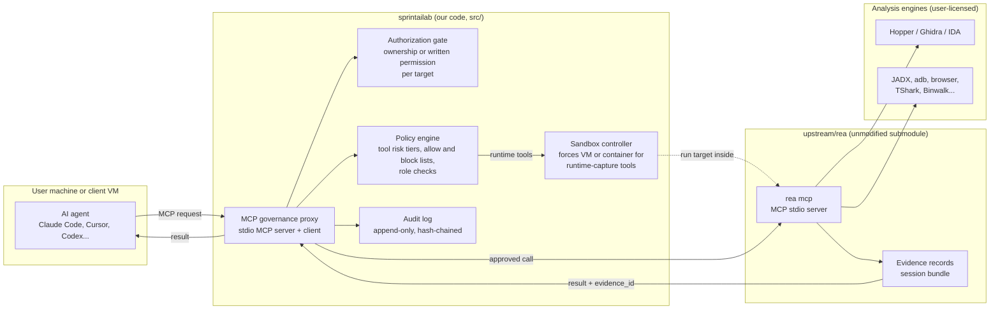

# Architecture

Status: **partly implemented**. REA facts below come from the upstream README and its
`docs/architecture.mermaid`.

| Component | State |
| --- | --- |
| MCP governance proxy (`src/proxy.ts`, `src/index.ts`) | Built, tested against real REA 6.6.0 |
| Policy engine (`src/policy.ts`) | Built: tier limit and fail-closed unknown tools. No roles yet |
| Audit log (`src/audit.ts`) | Built: hash-chained JSONL with `verifyChain` |
| Authorization gate | Not built. Tiers 2 and 3 are simply denied for now |
| Sandbox controller | Not built |

## Idea in one line

Put a **governance proxy** between the AI agent and REA. The agent talks MCP to our
proxy; our proxy decides whether a request may reach REA, records it, and passes
approved calls to an unmodified REA process.

## Why a proxy and not a fork of REA's internals

- REA ships fixes very quickly. Untouched upstream means we can update the
  submodule instead of re-merging a fork.
- REA already speaks MCP over stdio (`rea mcp`). A proxy can speak the same
  protocol on both sides, so agents need no changes beyond pointing at us.
- Policy lives in one small codebase we own and can test and audit.

## Component view

## Trust boundaries

| Boundary | What crosses it | Control |
| --- | --- | --- |
| Agent to proxy | Tool calls and target paths or URLs | Authentication, authorization gate, policy check |
| Proxy to REA | Only approved calls | Proxy is the only registered MCP server; REA is not exposed directly |
| REA to engines | Local process calls | Engines are user-licensed; REA owns process lifetime |
| Agent to model provider | Tool results (Evidence) | Provider choice and data-residency review (client contract) |

## What is REA's and what is ours

| Concern | Owner |
| --- | --- |
| Analysis of binaries, Electron, APK, web, .NET, firmware | REA (upstream) |
| Evidence records with limitations and `evidence_id` | REA (upstream) |
| Who may analyze what, and proof of permission | Ours |
| Tool risk tiers and blocked target categories | Ours |
| Audit trail and reporting | Ours |
| Isolation of runtime-capture tools | Ours |

## Known limits of this design

- A user who runs upstream REA directly bypasses our controls. Guardrails reduce
  misuse inside our product; they cannot stop it everywhere.
- The authorization gate records a **declaration**. It does not prove ownership.
  Contracts and client onboarding must back it up.
- Tool risk tiers come from REA's generated tool catalog and effect flags; see
  `docs/governance/tool-tiers.md`. They must be regenerated whenever upstream changes.

## Open decisions

1. Implementation language: TypeScript on Node (matches REA and the MCP SDK) is the
   default assumption.
2. Where the audit log is stored: local file per workstation versus central store.
3. Sandbox technology: Docker, a VM, or a managed cloud workspace.
