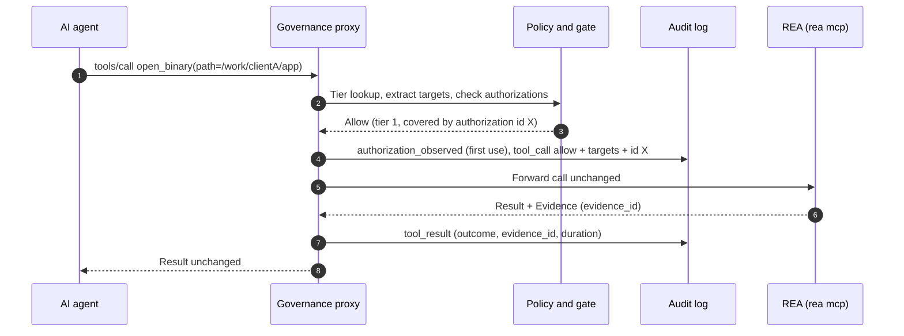
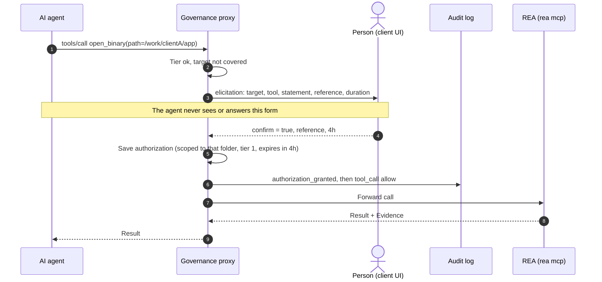
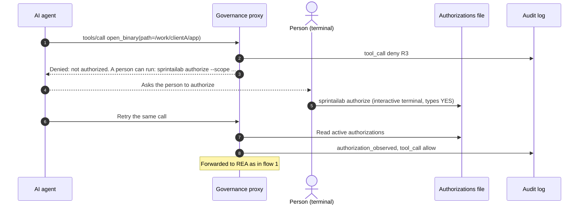
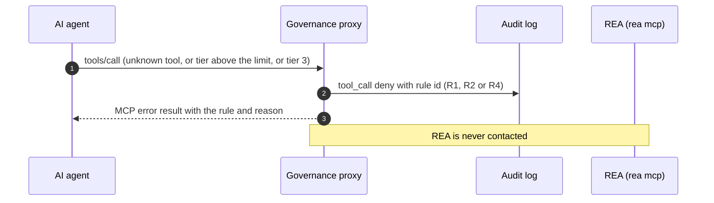
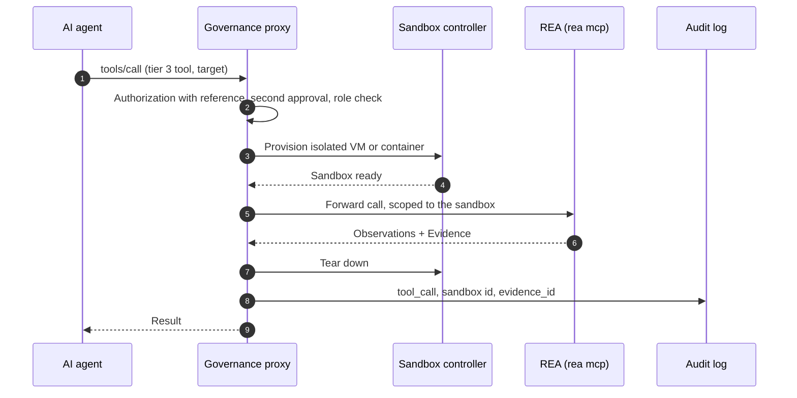

# Sequence diagrams

Status: **implemented** for flows 1 to 4. Flow 5 is future work (no sandbox yet).

## 1. Call covered by an existing authorization

## 2. Not yet authorized: the person is asked (client supports prompts)

If the person declines, cancels, leaves the box unticked, or omits a required reference, the call is
denied with rule R5 and `authorization_declined` is logged.

## 3. Not authorized and the client cannot prompt (terminal path)

## 4. Denied without contacting REA

## 5. Runtime-capture tool inside a sandbox (future)

Today every tier 3 tool is denied (R4). The intended flow once a sandbox controller exists:

